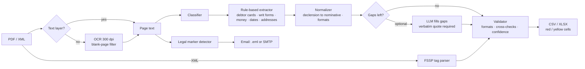

<div align="center">

# ⚖️ CourtLens

**Turn stacks of court and bailiff paperwork into clean tables, and put the acts that need a lawyer on the right desk, automatically.**

`PDF text layer` · `scanned PDF (OCR)` · `FSSP XML` → **CSV / XLSX** · **email to the lawyer** · **web UI**

*Built for the hackathon semifinal "AI assistants for the energy sector".*

</div>

---

## Why this exists

An energy company's collections team receives court orders, writs of execution and bailiff (FSSP) resolutions
by the hundreds. Someone has to open each one, retype the debtor, the address, the claim period, the principal, the
penalties and the state duty into a table, and, crucially, notice the rare act that needs a lawyer
(a refusal, a returned claim, a settlement, a reversed decision) before the deadline passes.

CourtLens does the reading, typing and triage. It tells you **which fields it is sure about, which it is not, and
which it could not find**, so a human only looks where a human is needed.

## What it does

| | |
|---|---|
| 📄 **Reads anything in the batch** | PDFs with a text layer, scans (Tesseract OCR, blank back-sides discarded) and FSSP XML |
| 🧭 **Knows what it is looking at** | court order / writ of execution, electronic or scanned, FSSP resolution |
| 🧾 **Fills your template** | 20 court fields and 24 FSSP columns exactly as in the provided templates, CSV and XLSX |
| 🚦 **Is honest about doubt** | missing fields are red, low-confidence fields are yellow, with a note explaining why. Nothing is guessed |
| ⚖️ **Finds acts for the lawyer** | 10 marker phrases, matched through word forms, OCR noise and gaps (`decision … reverse`) |
| ✉️ **Notifies the right person** | email with the original act attached: save as `.eml` files **or** send via SMTP, configured in the UI |
| 👥 **Handles multi-debtor writs** | one extra row per debtor, because the table row cannot be predicted from the text |
| 🔁 **Model-agnostic** | any OpenAI-compatible endpoint; swap the model in `config.yaml`, no code changes |

## How it works



**Design principles**

1. **Rules first, model second.** These documents are templated, so deterministic extraction is faster, cheaper
   and more predictable than a model. The LLM is an optional safety net for gaps, not the engine.
2. **Quote or it didn't happen.** A value from the model is accepted only if a verbatim quote exists in the document
   text. This blocks hallucinated numbers, a real risk in legal data.
3. **Never silently guess.** If OCR lost a digit, the field is flagged as missing rather than "repaired".
4. **Evidence travels with the value.** Every field keeps its source quote, page, confidence and note (see the
   `Details` sheet in the XLSX).
5. **The document is data, not instructions.** The model prompt treats document text as untrusted input.
6. **One bad file never stops the batch.** Errors are isolated per file and reported.

### A few things that were harder than they look

- **Which debtor?** Writs list several debtors. Names are matched by stems so that case endings and OCR noise do not
  split one person into two; sums are read from the clause that names the main debtor.
- **OCR-tolerant money, dates and case numbers.** `руб.`, `рублей`, `ров.`, `!` for `1`, dates split by spaces; a
  partly read date is reported as missing with a note instead of being invented.
- **Scans with blank sides.** Some 8-page writs have a blank reverse on every other page that OCR turns into noise.
  A confidence filter drops those pages before parsing.
- **Different writ layouts.** Cards ("The debtor under the enforcement document is…") and plain blocks
  (`Name, 17.02.1931, Resid.: …`) are both supported; garbled names in a block are repaired from clean spellings elsewhere
  in the same document.
- **FSSP address conventions.** `643,644117,55,,Test,,5 Obraztsovaya,50,138` becomes `г Тест, ул. Образцовая 5-я`,
  house `38 Б` becomes `38/Б`, and the street type is taken from the resolution text.

## Results

Measured against the provided labelled samples (`data/labels/`):

| Set | Documents | Fields correct |
|---|---|---|
| Court acts (PDF text layer and scans) | 23 | **448 / 483 = 92.8%** |
| Same, best-matching debtor for multi-debtor writs | 23 | 462 / 483 = 95.7% |
| FSSP resolutions (XML) | 21 | **482 / 483 = 99.8%** |

> **Read this before quoting the numbers.** The rules were tuned on these same documents, so expect lower figures on
> unseen data. The best honest signal: on a new, previously unseen writ layout the first version scored **85.7%**
> and reached 92.8% after adding support for that layout. The single FSSP miss is a label that
> disagrees with its document (a date with a typo in the source text). Remaining court-act errors are OCR limits
> (garbled digits and surnames), blank label cells where the document does contain a value, and documents that
> contradict themselves. The model channel is **not** part of these numbers.

Reproduce:

```bash
python -m app process data17 --out out
python evaluation/evaluate.py out/result.csv data/labels/ocr.csv --only-present --errors
python evaluation/evaluate.py out/result.csv data/labels/ocr.csv --only-present --debtors out/result_debtors.csv
```

## Quick start

```bash
pip install -e .[dev]
sudo apt install tesseract-ocr poppler-utils       # system packages
# Russian OCR model: put rus.traineddata into data/tessdata/
#   https://github.com/tesseract-ocr/tessdata_fast
cp .env.example .env                               # LLM and SMTP settings (all optional)
```

**Web client**

```bash
python -m app serve        # http://127.0.0.1:8000
```

Drop PDFs and XML files, choose what happens with emails, press *Process*:

| Email mode | What happens |
|---|---|
| **Save as files** | `.eml` with the act attached, bundled into a downloadable archive; nothing is sent |
| **Send via SMTP** | sent immediately; STARTTLS / SSL / none; *Check connection* and *Send test email* buttons |
| **Off** | tables only; acts for the lawyer are still marked in the results |

**Command line**

```bash
python -m app process <folder> --out out/                       # rules only
python -m app process <folder> --out out/ --llm                 # + LLM gap filling
python -m app process <folder> --out out/ --notify --to lawyer@company.com \
       --smtp-host smtp.company.com --smtp-port 587 --smtp-user me --smtp-password ...
python -m pytest                                                # 29 tests
```

Without `--notify`, emails are written to `out/emails/*.eml`. The same file is never emailed twice (SHA-256 ledger).

Outputs: `result.csv|xlsx` (court acts), `result_xml.csv|xlsx` (FSSP), `result_debtors.csv` (one row per debtor).
The XLSX has three sheets: **Result**, **Details** (value, status, confidence, page, quote, note) and **For lawyer**
(matched phrase with context).

## Swapping the model

Everything model-related lives in `config.yaml`:

```yaml
llm:
  base_url: ${LLM_BASE_URL}     # any OpenAI-compatible endpoint
  model: gpt-oss-120b           # or qwen3.6-35b-a3b, or a Yandex model
  temperature: 0
```

Run a model locally (for example through Ollama, llama.cpp or vLLM) or use a hosted API, point `LLM_BASE_URL` at it and
add `--llm`. The core scenario does not depend on the model: without one, everything above still works.

## Project layout

```
app/
  ingestion/   text-layer probe per page          text/       loader + Tesseract OCR
  classify/    document type                      extract/    rules, writ forms, LLM gap filling
  xmlfssp/     FSSP XML parser                    normalize/  dates, money, names, addresses
  validate/    format and consistency checks      legal/      marker-phrase detector
  export/      CSV / XLSX with highlighting       notify/     .eml and SMTP, idempotent
  web/         FastAPI client                     service.py  shared batch core (CLI + web)
evaluation/    scoring against labels, OCR ablation
data/          labels, marker phrases             prompts/    LLM prompt
tests/         29 tests, fixtures
```

## Limitations (we would rather tell you)

- **OCR is the ceiling on poor scans.** Some dates, digits and co-debtor surnames are lost; these fields are flagged, not guessed.
- **Multi-debtor writs are ambiguous.** The reference table picks one debtor per act in a way the text does not reveal
  (sometimes the second, sometimes the sixth). The main table holds the first debtor, every debtor is in `result_debtors.csv`.
- **Self-contradicting documents** (for example different passports on the card and in the body) are not yet flagged
  automatically.
- **Marker phrases** containing `…` allow up to 200 characters between parts; broad phrases such as
  `decision … reverse` can over-trigger. There were no real "for the lawyer" samples to measure recall.
- **Not yet tested against production services:** the LLM channel (no model access during development) and
  SMTP delivery (verified against a local test server only).
- **SMTP password** is stored in `data/settings.json` in plain text, which is acceptable for a prototype. Use environment variables in production.
- The FSSP **PDF copies** are not parsed; their data comes from the paired XML.

## Roadmap

Automatic contradiction warnings · targeted re-OCR of problem regions · second OCR engine or vision model for bad
scans · per-field confidence calibration · queue-based processing for large batches.

---

<div align="center">

Russian version: [README.ru.md](README.ru.md)

</div>
